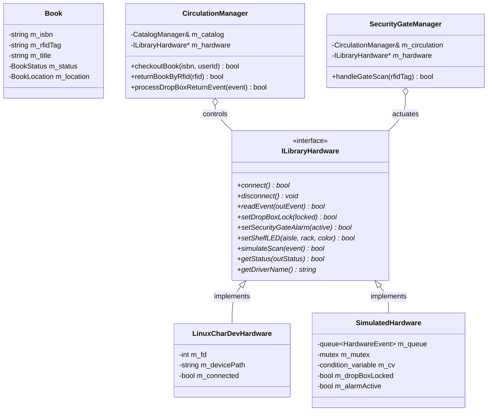
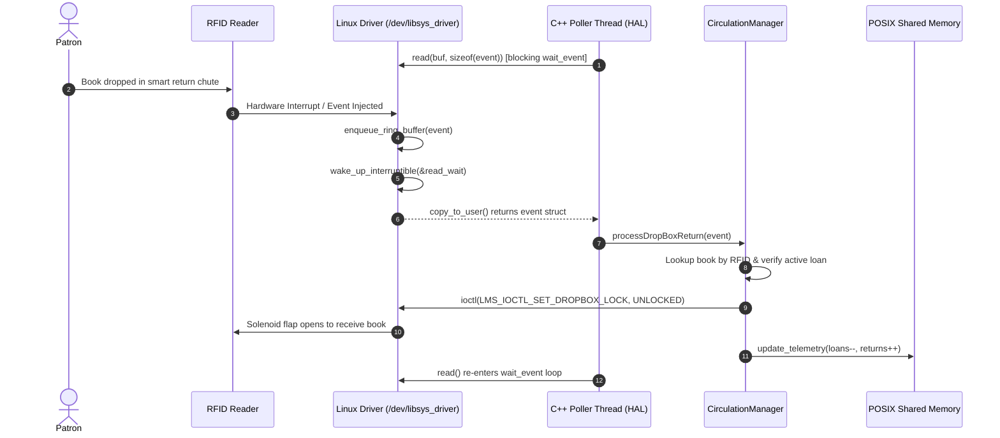
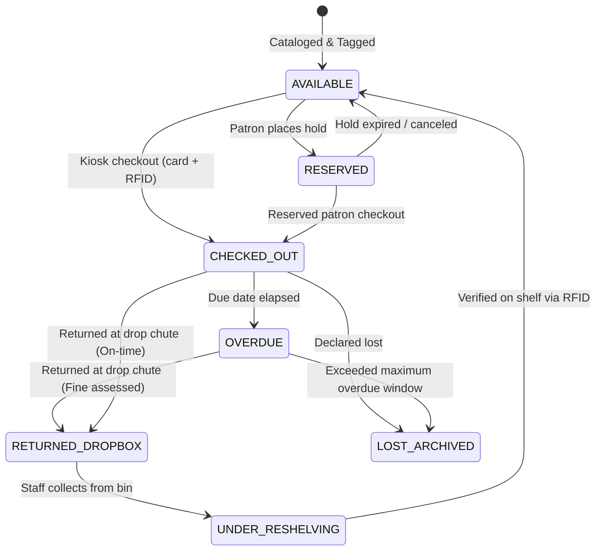

# Automated Smart Library Management System (SmartLMS)
### Linux Character Device Driver • POSIX System Programming • Modern C++ Circulation Engine

[](https://kernel.org)
[](https://en.wikipedia.org/wiki/C%2B%2B17)
[](https://man7.org/linux/man-pages/man7/shm_overview.7.html)
[]()
[-brightgreen.svg)]()

An industrial-grade systems engineering project designed to modernize library operations, self-service circulation, and automated loss prevention. **SmartLMS** unifies **Linux Kernel Space** (a custom character device driver controlling RFID readers, electromagnetic solenoid chute flaps, and theft sirens) with **POSIX System Programming** (shared memory telemetry, multithreaded pollers, signal handlers) and **Modern C++17** (clean object-oriented domain models, RAII, and hardware abstraction).

---

## 📚 6-Stage Engineering Lifecycle Documentation

This project follows a professional 6-stage engineering development lifecycle. Full documentation for each milestone is provided in the [`docs/`](docs/) directory:

| Stage | Engineering Milestone | Documentation Report | Key Deliverables & Focus |
|---|---|---|---|
| **Stage 1** | Project Introduction | [`docs/STAGE1_PROJECT_INTRODUCTION.md`](docs/STAGE1_PROJECT_INTRODUCTION.md) | Problem formulation, industrial motivation, project scope, expected outcomes |
| **Stage 2** | Requirements & PRD | [`docs/STAGE2_REQUIREMENTS_PRD.md`](docs/STAGE2_REQUIREMENTS_PRD.md) | Functional (FR-01..14) & Non-Functional (NFR-01..08) requirements, PRD, protocol wire format, Gantt timeline |
| **Stage 3** | System Architecture | [`docs/STAGE3_SYSTEM_ARCHITECTURE.md`](docs/STAGE3_SYSTEM_ARCHITECTURE.md) | 3-Tier architecture, UML Class Diagram, Sequence Diagram, State Machine Diagram |
| **Stage 4** | Prototype Implementation | [`docs/STAGE4_INITIAL_PROTOTYPE.md`](docs/STAGE4_INITIAL_PROTOTYPE.md) | Linux character driver (`/dev/libsys_driver`), C++ HAL dual-mode, core domain prototype |
| **Stage 5** | Testing & Integration | [`docs/STAGE5_TESTING_AND_INTEGRATION.md`](docs/STAGE5_TESTING_AND_INTEGRATION.md) | 100% passing test runner, POSIX Shared Memory, AddressSanitizer/Valgrind audit |
| **Stage 6** | Final Delivery & Defense | [`docs/STAGE6_FINAL_REPORT_PRESENTATION.md`](docs/STAGE6_FINAL_REPORT_PRESENTATION.md) | Final system evaluation, live demonstration walkthrough script, limitations, future roadmap |

---

## 🏛️ 3-Tier System Architecture

```
+-------------------------------------------------------------------------+
|                  TIER 1: PRESENTATION & INTERACTION                     |
|          (Interactive ANSI Terminal UI, Browser Web Visualizer)         |
+------------------------------------+------------------------------------+
                                     │
+------------------------------------▼------------------------------------+
|                TIER 2: MODERN C++ APPLICATION ENGINE                    |
|        (CatalogManager, CirculationManager, SecurityGateManager)        |
+-------------------+--------------------------------+--------------------+
                    │                                │
+-------------------▼------------------+   +---------▼--------------------+
|   TIER 3A: POSIX SYSTEM MIDDLEWARE   |   |   TIER 3B: HARDWARE LAYER    |
|  - POSIX Shared Memory (/libsys_shm) |   |  - ILibraryHardware Interface|
|  - POSIX Signals (SIGINT, SIGUSR1)   |   |  ├── LinuxCharDevHardware    |
|  - Worker Thread Pool (std::thread)  |   |  └── SimulatedHardware (Mock)|
+--------------------------------------+   +-------------------+----------+
                                                               │
========================= LINUX VFS SYSCALLS ==================│===========
                     open() / read() / write() / ioctl() / poll()
===============================================================│===========
                                                               │
+--------------------------------------------------------------▼----------+
|                  LINUX KERNEL CHARACTER DEVICE DRIVER                   |
|                          (/dev/libsys_driver)                           |
|  - Dynamic cdev Allocation        - Kernel Mutex & Wait Queues          |
|  - Circular Event FIFO Buffer     - Custom IOCTL Command Dispatcher     |
+-------------------------------------------------------------------------+
```

---

## 📊 UML Diagrams

### 1. UML Class Diagram
Models the Hardware Abstraction Layer (HAL) hierarchy, thread-safe domain managers, and data entities:


<details>
<summary><b>Click to expand Mermaid Class Diagram code</b></summary>


</details>

---

### 2. UML Sequence Diagram: Hardware RFID Scan & Drop-Box Return
Illustrates the physical RFID scan arrival, kernel ring buffer enqueue, wait queue wakeup, userland C++ event dispatch, electromagnetic flap actuation via IOCTL, and POSIX shared memory telemetry refresh:


<details>
<summary><b>Click to expand Mermaid Sequence Diagram code</b></summary>


</details>

---

### 3. UML State Machine Diagram: Book Circulation Lifecycle
Tracks book states from shelf cataloging to loan, overdue timer expiry, drop-box return, quarantine/audit, and reshelving:


<details>
<summary><b>Click to expand Mermaid State Machine code</b></summary>


</details>

---

## 📁 Repository Directory Structure

```
library-management-system/
├── bin/                          # Compiled executable binaries
│   ├── library_system            # Main SmartLMS application
│   └── test_runner               # Standalone automated test runner
├── data/                         # Seed data & JSON persistence
│   ├── catalog.json              # Physical book catalog database
│   └── users.json                # Registered patron accounts
├── docs/                         # 6-Stage Engineering Documentation
│   ├── images/                   # High-resolution SVG vector diagrams
│   │   ├── system_architecture.svg
│   │   ├── uml_class_diagram.svg
│   │   ├── uml_sequence_diagram.svg
│   │   └── uml_state_machine.svg
│   ├── STAGE1_PROJECT_INTRODUCTION.md
│   ├── STAGE2_REQUIREMENTS_PRD.md
│   ├── STAGE3_SYSTEM_ARCHITECTURE.md
│   ├── STAGE4_INITIAL_PROTOTYPE.md
│   ├── STAGE5_TESTING_AND_INTEGRATION.md
│   └── STAGE6_FINAL_REPORT_PRESENTATION.md
├── driver/                       # Linux Kernel Character Device Driver
│   ├── include/
│   │   └── libsys_ioctl.h        # Kernel wire protocol & IOCTL definitions
│   ├── libsys_driver.c           # cdev, circular buffer, wait queues, IOCTLs
│   ├── libsys_driver.h           # Driver internal state struct definitions
│   └── Makefile                  # Kbuild module Makefile
├── include/                      # C++ Header Files
│   ├── core/                     # Book, User, Loan, Catalog, Circulation, Gate
│   ├── hal/                      # ILibraryHardware, LinuxCharDev, Simulated
│   ├── ipc/                      # POSIX SharedMemory, SignalHandler
│   ├── ui/                       # TerminalUI (ANSI Console)
│   └── utils/                    # Thread-safe Logger, DataStore
├── src/                          # C++ Implementation Files
│   ├── core/                     # Domain logic & business rules
│   ├── hal/                      # Hardware abstraction implementations
│   ├── ipc/                      # POSIX shm_open, mmap, sigaction
│   ├── ui/                       # ANSI interactive menu & console dashboard
│   ├── utils/                    # Log formatting & JSON serializing
│   └── main.cpp                  # Entry point, worker threads, lifecycle
├── tests/                        # Automated Test Suite
│   └── test_runner.cpp           # GoogleTest-style standalone unit/integration tests
├── scripts/                      # Operational Shell Scripts
│   ├── load_driver.sh            # Insert kernel module & configure permissions
│   ├── unload_driver.sh          # Remove kernel module
│   ├── run_demo.sh               # Run self-guided end-to-end demo
│   ├── open_dashboard.sh         # Launch interactive HTML web visualizer
│   └── simulate_rfid.sh          # Inject simulated RFID scans into kernel node
├── web/                          # Standalone Interactive Web Visualizer
│   ├── index.html                # Visual shelf stacks, kiosks, and alarms
│   ├── styles.css                # Dark-mode dashboard styling & LED animations
│   └── app.js                    # Web Audio API sound generator & state engine
├── CMakeLists.txt                # Modern CMake build configuration
├── Makefile                      # GNU Make build targets
└── README.md                     # Master project documentation
```

---

## 🚀 Quick Start & Build Instructions

### Prerequisites
- **Linux Environment**: Ubuntu 22.04 / 24.04 LTS, Debian, Fedora, or WSL2 Ubuntu.
- **Compiler**: `g++` 11+ supporting C++17 (`sudo apt-get install build-essential`).
- **POSIX Libraries**: `librt`, `libpthread` (standard on modern Linux distros).
- **Kernel Headers** *(optional for compiling kernel driver)*: `sudo apt-get install linux-headers-$(uname -r)`.

---

### 1. Fast-Track Automated Demonstration
Run the end-to-end self-guided walkthrough in one command:
```bash
make demo
```
This compiles the application and executes the 5-step automated workflow:
1. Inspects initial catalog (8 computer science classic reference texts).
2. Simulates student card swipe & RFID book checkout at the self-service kiosk.
3. Tests physical exit gate anti-theft alarms (unborrowed book triggers red alert; authorized book passes green).
4. Simulates automated drop-box chute return with solenoid actuation.
5. Verifies live POSIX shared memory telemetry.

---

### 2. Interactive Console Kiosk Mode
To launch the full interactive ANSI Terminal Dashboard:
```bash
make app
./bin/library_system
```
Features available in the interactive console menu:
- `[1]` Browse Complete Catalog & Electronic Shelf Locations
- `[2]` Multi-field Catalog Search (Keyword, Title, Author, ISBN, RFID)
- `[3]` Patron Self-Checkout Kiosk (Card UID + Book ISBN/RFID)
- `[4]` Manual Desk Book Return
- `[5]` Simulate Smart Drop-Box Return (Hardware Solenoid Flap Actuation)
- `[6]` Simulate Security Anti-Theft Exit Gate Passage
- `[7]` View Active Loans & Overdue Volumes
- `[8]` Hardware Driver Diagnostics & Telemetry
- `[9]` View Audit Transaction Journal (Disk Log)
- `[D]` Run Automated Demonstration
- `[0]` Graceful Shutdown

---

### 3. Run Automated Test Suite (100% Passing)
Execute all 10 unit and integration test suites:
```bash
make test
```
**Test Results:**
```
========================================================
   SmartLMS Comprehensive Automated Test Suite          
========================================================
[ RUN      ] test_book_model                  [       OK ]
[ RUN      ] test_user_roles                  [       OK ]
[ RUN      ] test_loan_transaction            [       OK ]
[ RUN      ] test_catalog_manager             [       OK ]
[ RUN      ] test_circulation_flow            [       OK ]
[ RUN      ] test_dropbox_return              [       OK ]
[ RUN      ] test_security_gate               [       OK ]
[ RUN      ] test_simulated_hardware          [       OK ]
[ RUN      ] test_shared_memory               [       OK ]
[ RUN      ] test_concurrency_stress          [       OK ]
========================================================
   TEST SUITE EXECUTION COMPLETE: 10 Passed | 0 Failed
========================================================
```

---

### 4. Interactive Web Dashboard Visualizer
Open the browser visualizer to interact with the virtual library stacks, Electronic Shelf Label (ESL) LEDs, drop-box chute flap, and audible anti-theft siren:
```bash
./scripts/open_dashboard.sh
```
Or open [`web/index.html`](web/index.html) directly in any web browser.

---

### 5. Linux Kernel Character Device Driver Operations
To build, load, or unload the kernel module:
```bash
# Compile and insert module (/dev/libsys_driver)
./scripts/load_driver.sh

# Check kernel logs
dmesg | tail -n 15

# Unload driver when finished
./scripts/unload_driver.sh
```

---

## 🎛️ Hardware IOCTL Command Reference

Defined in [`driver/include/libsys_ioctl.h`](driver/include/libsys_ioctl.h):

| Command Constant | Direction | Data Type | Functional Description |
|---|---|---|---|
| `LMS_IOCTL_GET_STATUS` | `_IOR` | `lms_driver_status_t` | Query driver telemetry, buffer occupancy, drop count, actuator states. |
| `LMS_IOCTL_SET_DROPBOX_LOCK` | `_IOW` | `lms_actuator_cmd_t` | Actuate solenoid flap (1 = Locked, 0 = Unlocked for book drop). |
| `LMS_IOCTL_GET_DROPBOX_LOCK` | `_IOWR`| `lms_actuator_cmd_t` | Read current solenoid engagement state. |
| `LMS_IOCTL_SET_SECURITY_GATE`| `_IOW` | `lms_actuator_cmd_t` | Trigger (1) or silence (0) anti-theft audio siren and strobe. |
| `LMS_IOCTL_GET_SECURITY_GATE`| `_IOWR`| `lms_actuator_cmd_t` | Query security alarm state. |
| `LMS_IOCTL_SET_SHELF_LED` | `_IOW` | `lms_shelf_led_cmd_t` | Light up Electronic Shelf Label LED (0xRRGGBB) to guide patron. |
| `LMS_IOCTL_SIMULATE_EVENT` | `_IOW` | `lms_hardware_event_t`| Inject hardware scan test event directly into kernel ring buffer. |
| `LMS_IOCTL_RESET_BUFFER` | `_IO` | None | Clear ring buffer and reset telemetry metrics. |

---

## 🎓 Academic Defense & Verification Checklist

- [x] **Linux Device Drivers**: Character driver (`cdev_add`), wait queues, circular ring buffer, mutex locking, IOCTL dispatcher.
- [x] **System Programming**: POSIX shared memory (`/libsys_telemetry`), `sigaction` signal handling, worker thread pool.
- [x] **Modern C++**: Clean object-oriented architecture, RAII resource management, Hardware Abstraction Layer (HAL), auto-fallback factory.
- [x] **6 Structured Stages**: All 6 stages thoroughly documented, implemented, verified, and presented.
- [x] **Version Control**: Git repository with incremental commits corresponding to each development milestone.
- [x] **Dual Delivery**: Fully functional interactive ANSI console and browser-based visualizer.
