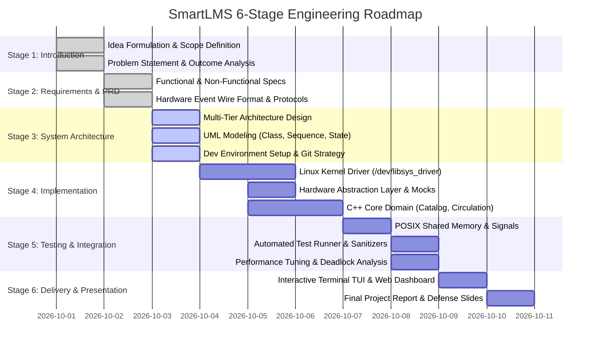

# Stage 2: Project Requirements & Development Plan
## Product Requirements Document (PRD) & Engineering Roadmap
### Automated Smart Library Management System (SmartLMS)

---

## 1. Executive Summary & User Personas

The **Automated Smart Library Management System (SmartLMS)** bridges embedded hardware peripherals (RFID readers, solenoid locks, anti-theft sensors) with a high-performance C++ backend under Linux. 

### User Personas

| Persona | Role | Primary Responsibilities / Goals | Core System Interaction |
|---|---|---|---|
| **Dr. Elena Vance** | University Chief Librarian | Oversees inventory accuracy, catalog audits, and loss mitigation. | Admin Console, Audit Logs, Telemetry Inspection. |
| **Marcus Brody** | Library Operations Specialist | Manages shelf organization, repairs damaged RFID tags, returns. | Smart Book Drop, Shelf Locator, Hardware Diagnostics. |
| **Alex Chen** | Student / Research Patron | Borrows and returns books independently, searches catalog. | Self-Service Kiosk, Live Availability Search. |
| **Systems Administrator** | Embedded DevOps Engineer | Maintains kernel driver stability, monitors IPC telemetry and health. | Driver CLI (`insmod`/`rmmod`), Shared Memory Monitor. |

---

## 2. Functional Requirements (FR)

### Module 1: Linux Character Device Driver (Kernel Space)
- **FR-01 (Device Registration)**: The kernel module must register a character device `/dev/libsys_driver` with dynamic major number allocation and automatic class/device node creation under sysfs/udev.
- **FR-02 (Event Buffering)**: The driver must maintain a circular FIFO ring buffer of at least 64 hardware scan events, safeguarded by kernel mutexes or spinlocks.
- **FR-03 (Synchronous & Asynchronous I/O)**: The driver must support blocking `read()` with `wait_event_interruptible()`, non-blocking `O_NONBLOCK` read semantics, and `poll()` support.
- **FR-04 (Hardware IOCTL Control)**: The driver must support IOCTL operations for:
  - Querying driver status (`LMS_IOCTL_GET_STATUS`)
  - Actuating smart drop-box solenoid lock (`LMS_IOCTL_SET_DROPBOX_LOCK`)
  - Triggering security gate buzzer/LED alarm (`LMS_IOCTL_SET_SECURITY_GATE`)
  - Illuminating shelf sector locator LEDs (`LMS_IOCTL_SET_SHELF_LED`)
  - Injecting diagnostic test events (`LMS_IOCTL_SIMULATE_EVENT`)
  - Resetting buffer metrics (`LMS_IOCTL_RESET_BUFFER`)

### Module 2: POSIX System Programming & Middleware
- **FR-05 (Multithreaded Event Polling)**: The application must run an independent hardware poller thread that continuously reads from the driver or mock device without freezing the main application.
- **FR-06 (POSIX Shared Memory Telemetry)**: The application must create and maintain a POSIX shared memory segment (`/libsys_telemetry`) containing live counts of active loans, gate alarms, drop-box events, and driver status.
- **FR-07 (POSIX Signal Management)**: The application must catch `SIGINT` and `SIGTERM` to perform graceful resource cleanup (unmapping shared memory, closing descriptors, joining worker threads) and `SIGUSR1` to dump telemetry to stdout.
- **FR-08 (Thread-Safe Transaction Journal)**: Every checkout, return, gate security breach, and hardware failure must be logged atomically to `libsys_audit.log` with high-resolution timestamps.

### Module 3: Modern C++ Core Application & Domain Logic
- **FR-09 (Catalog & Location Indexing)**: Maintain in-memory catalog with multi-index search (by ISBN, title, author, category, or RFID tag UID) and physical shelf coordinates (Aisle, Rack, Shelf).
- **FR-10 (Circulation & Policies)**:
  - User borrow quota enforcement based on role (e.g., Student: 3 books for 14 days; Faculty: 10 books for 30 days).
  - Overdue fine calculation and loan renewal management.
  - Automated return handling: when a book is placed in the drop-box, tag UID is read, loan is closed, and solenoid unlocks to accept the volume.
- **FR-11 (Security Anti-Theft Validation)**: The security gate listener compares tag UIDs passing through the exit gate against current active loan states. If an unloaned book passes through, trigger the gate alarm via IOCTL.
- **FR-12 (Hardware Abstraction Layer & Fallback)**: Provide a clean polymorphic C++ HAL (`ILibraryHardware`) with automatic fallback to an in-memory simulated hardware engine when the kernel module is not installed.

### Module 4: Presentation & Visualization
- **FR-13 (Interactive Terminal UI)**: ANSI-color interactive console menu supporting catalog search, circulation actions, hardware diagnostic console, and live event monitoring.
- **FR-14 (Live Web Visualizer)**: A standalone browser-based dashboard visualizing library aisles, racks, book drop box, kiosk activity, and shared memory telemetry.

---

## 3. Non-Functional Requirements (NFR)

| ID | Requirement | Target Metric / Acceptance Criteria |
|---|---|---|
| **NFR-01** | **Scan Latency** | Hardware RFID scan event delivery to user-space processing in < 5 milliseconds. |
| **NFR-02** | **Kernel Safety** | Zero kernel panics, null pointer dereferences, or memory leaks; all user-space memory copies protected via `copy_to_user()` / `copy_from_user()`. |
| **NFR-03** | **Concurrency & Thread Safety** | Race-condition free; all shared resources guarded by `std::mutex`, `std::unique_lock`, or POSIX mutexes; verified via AddressSanitizer and ThreadSanitizer. |
| **NFR-04** | **Data Persistence & Integrity** | Catalog and user records persisted to structured JSON; audit log writes flushed to disk synchronously. |
| **NFR-05** | **Portability & Graceful Degradation** | 100% executable in pure user-space mock mode on systems where root/kernel module loading is restricted. |
| **NFR-06** | **Resource Utilization** | Background daemon consumes < 25 MB RAM and < 2% CPU during idle polling. |
| **NFR-07** | **Code Standards & Clean Architecture** | Modern C++17 standard, strict compiler warnings (`-Wall -Wextra -Wpedantic`), RAII throughout, modular separation. |
| **NFR-08** | **Zero-Loss Graceful Termination** | On `SIGINT`/`SIGTERM`, the system must flush buffers, unlink shared memory, and cleanly terminate all background threads within 500 ms. |

---

## 4. Hardware Event Specification (Protocol & Wire Format)

```c
typedef struct {
    uint32_t event_id;                     /* Monotonically increasing event ID */
    uint64_t timestamp_ns;                 /* Hardware timestamp in nanoseconds */
    char     tag_uid[32];                  /* RFID / NFC Tag UID or ISBN */
    char     user_card_uid[32];            /* Patron ID card UID (if kiosk) */
    uint8_t  event_type;                   /* 1: Kiosk Scan, 2: DropBox Return, 3: Gate Scan */
    uint8_t  gate_or_kiosk_id;             /* Physical terminal identifier (1..8) */
    uint8_t  signal_strength;              /* RSSI value (0..100) */
    uint8_t  status_flags;                 /* Bitmask: 0x01 = Solenoid Engaged, 0x02 = Alarm Active */
} lms_hardware_event_t;
```

---

## 5. Development Plan & Timeline (6-Stage Roadmap)



---

## 6. Deliverables & Acceptance Matrix

| Stage | Milestone | Primary Artifacts | Success Criteria |
|---|---|---|---|
| **Stage 1** | Project Introduction | `STAGE1_PROJECT_INTRODUCTION.md` | Problem statement clearly articulated with industrial relevance. |
| **Stage 2** | Requirements & PRD | `STAGE2_REQUIREMENTS_PRD.md` | PRD with numbered FRs, NFRs, wire protocols, and Gantt roadmap. |
| **Stage 3** | System Architecture | `STAGE3_SYSTEM_ARCHITECTURE.md`, UML SVGs | 3-tier architecture, UML Class, Sequence, State diagrams. |
| **Stage 4** | Core Prototype | `driver/`, `include/hal/`, `src/core/` | Working kernel module + user-space C++ circulation prototype. |
| **Stage 5** | Testing & Integration | `tests/test_runner.cpp`, `src/ipc/` | 100% passing tests, memory verification, signal handling. |
| **Stage 6** | Final Delivery | Terminal TUI, Web Visualizer, `STAGE6_...` | Complete runnable solution, presentation, full documentation. |
