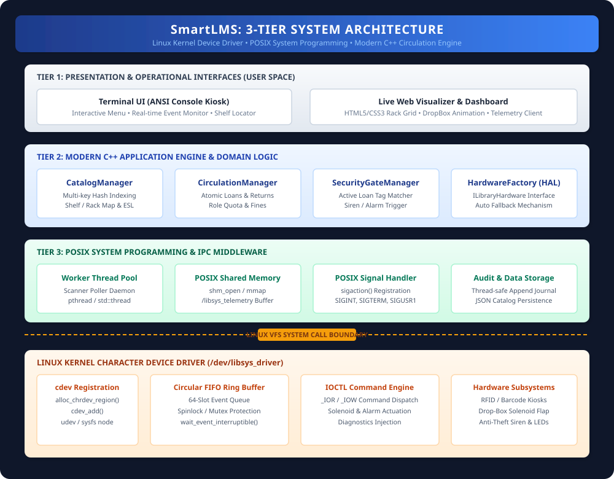
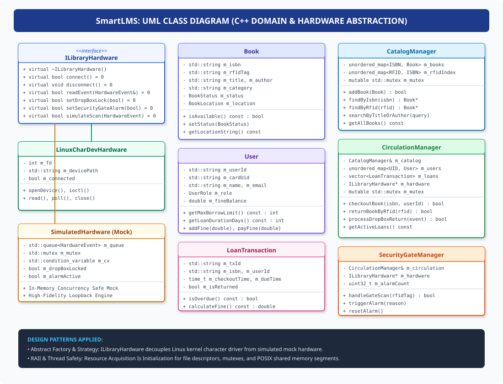
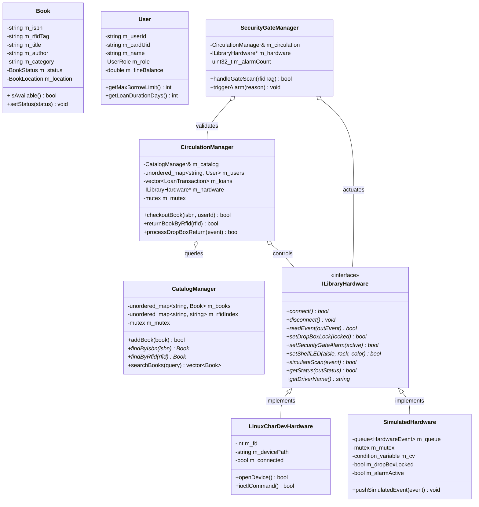
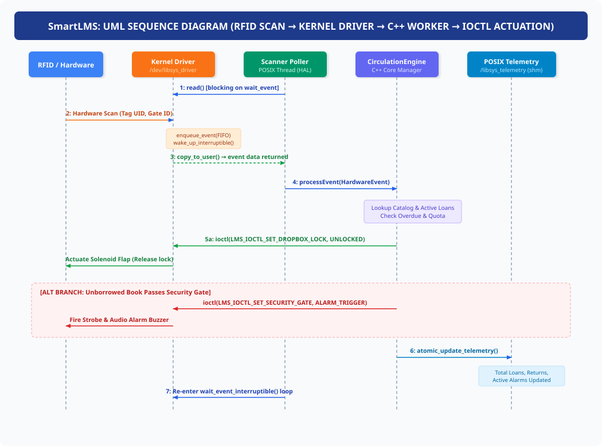
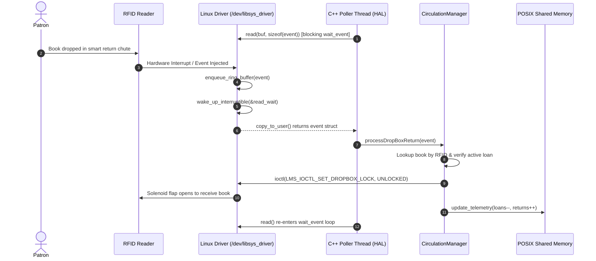
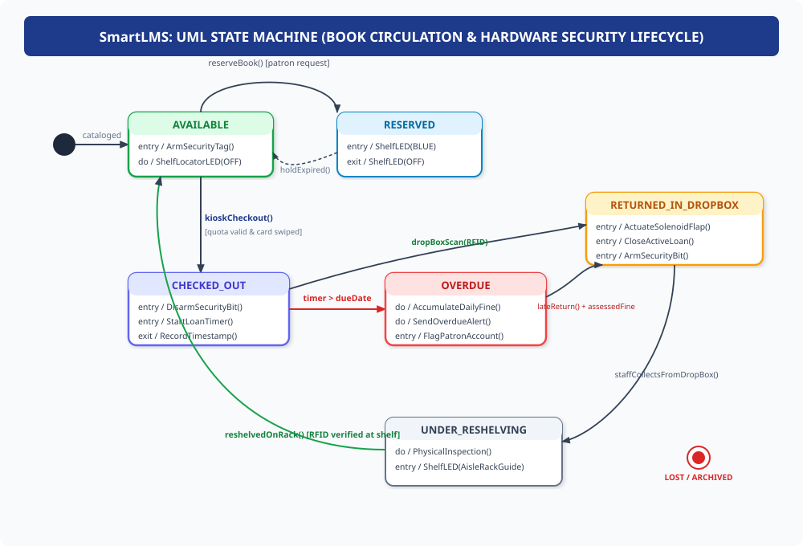
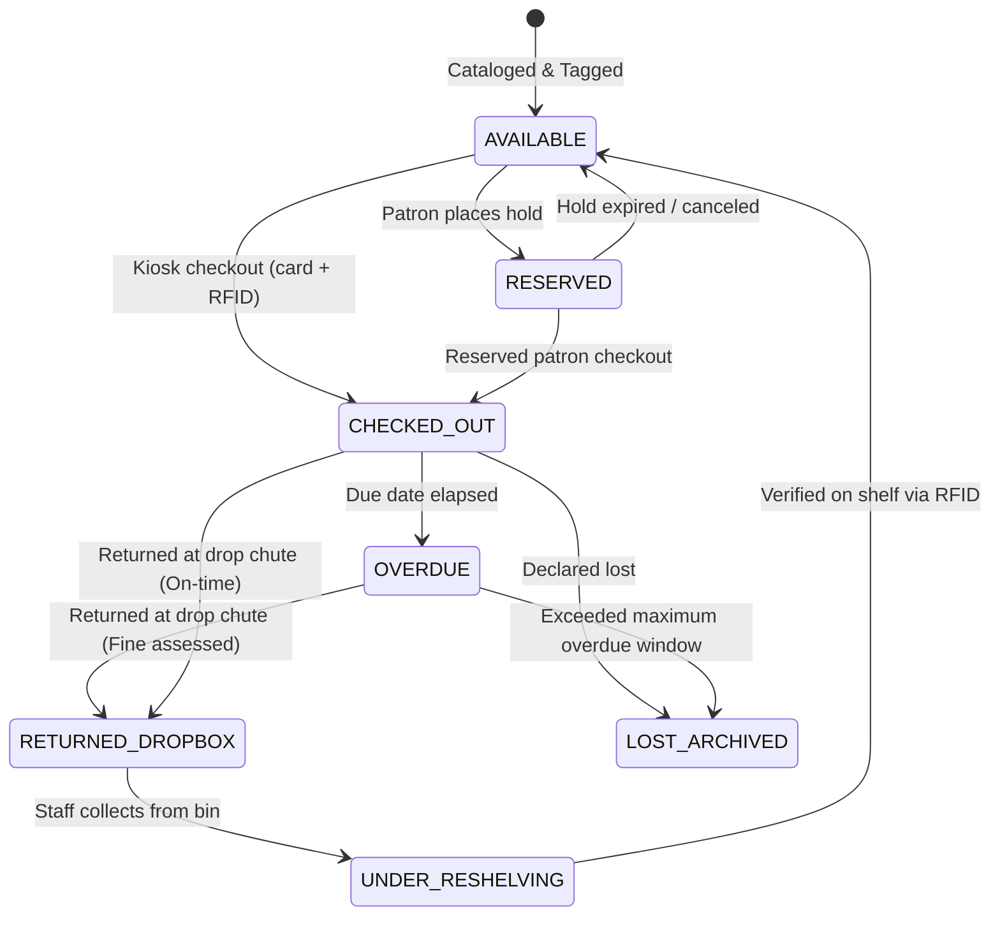

# Stage 3: System Design & Architecture
## Detailed Architectural Blueprint, UML Models, and Data Structures
### Automated Smart Library Management System (SmartLMS)

---

## 1. System Architecture Overview

The **Automated Smart Library Management System (SmartLMS)** is organized into three decoupled, cohesive tiers spanning Linux Kernel Space and Linux User Space:

```
+-------------------------------------------------------------------------+
|                  TIER 1: PRESENTATION & INTERACTION                     |
|          (Interactive ANSI Terminal UI, Browser Web Visualizer)         |
+------------------------------------+------------------------------------+
                                     │
+------------------------------------▼------------------------------------+
|                TIER 2: MODERN C++ APPLICATION ENGINE                    |
|        (CatalogManager, CirculationManager, SecurityGateManager)        |
+-------------------+--------------------------------+--------------------+
                    │                                │
+-------------------▼------------------+   +---------▼--------------------+
|   TIER 3A: POSIX SYSTEM MIDDLEWARE   |   |   TIER 3B: HARDWARE LAYER    |
|  - POSIX Shared Memory (/libsys_shm) |   |  - ILibraryHardware Interface|
|  - POSIX Signals (SIGINT, SIGUSR1)   |   |  ├── LinuxCharDevHardware    |
|  - Worker Thread Pool (std::thread)  |   |  └── SimulatedHardware (Mock)|
+--------------------------------------+   +-------------------+----------+
                                                               │
========================= LINUX VFS SYSCALLS ==================│===========
                     open() / read() / write() / ioctl() / poll()
===============================================================│===========
                                                               │
+--------------------------------------------------------------▼----------+
|                  LINUX KERNEL CHARACTER DEVICE DRIVER                   |
|                          (/dev/libsys_driver)                           |
|  - Dynamic cdev Allocation        - Kernel Mutex & Wait Queues          |
|  - Circular Event FIFO Buffer     - Custom IOCTL Command Dispatcher     |
+-------------------------------------------------------------------------+
```

---

## 2. Architecture Diagrams

### System Architecture Diagram


---

## 3. Major System Components & Responsibilities

### A. Linux Kernel Character Device Driver (`/dev/libsys_driver`)
- **Node Management**: Registers character device via `alloc_chrdev_region()`, `cdev_init()`, and `cdev_add()`, exposing `/dev/libsys_driver` via `class_create()` and `device_create()`.
- **FIFO Event Queue**: Fixed-size circular buffer (capacity: 64 hardware events) protected by a kernel `struct mutex`.
- **Wait Queue Concurrency**: Implements `wait_queue_head_t read_wait` for sleep-wait blocking `read()` with `wait_event_interruptible()`, avoiding wasteful CPU busy-waiting.
- **IOCTL Dispatch Engine**:
  - `LMS_IOCTL_GET_STATUS`: Fetches buffer metrics, dropped events, and solenoid/siren states.
  - `LMS_IOCTL_SET_DROPBOX_LOCK`: Controls electromagnetic solenoid flap for book returns.
  - `LMS_IOCTL_SET_SECURITY_GATE`: Activates or silences anti-theft gate sirens and visual strobes.
  - `LMS_IOCTL_SET_SHELF_LED`: Controls aisle/rack guide LEDs for book location assistance.
  - `LMS_IOCTL_SIMULATE_EVENT`: Enables injecting hardware scan test events into the ring buffer.
  - `LMS_IOCTL_RESET_BUFFER`: Empties ring buffer and resets driver statistics.

### B. Hardware Abstraction Layer (HAL)
- **`ILibraryHardware` Interface**: Pure virtual C++ interface abstracting all low-level hardware interactions.
- **`LinuxCharDevHardware`**: Concrete implementation interfacing with `/dev/libsys_driver` using Linux VFS system calls (`open()`, `read()`, `write()`, `ioctl()`, `poll()`).
- **`SimulatedHardware`**: Thread-safe in-memory mock simulator featuring a mutex-guarded queue and condition variable, providing complete functional parity when running without kernel privileges.
- **`HardwareFactory`**: Detects if `/dev/libsys_driver` exists; if available, instantiates `LinuxCharDevHardware`; otherwise, seamlessly falls back to `SimulatedHardware` with an explicit console notice.

### C. POSIX System Programming Middleware
- **POSIX Shared Memory (`/libsys_telemetry`)**: Allocates shared memory via `shm_open()`, `ftruncate()`, and `mmap()`, exposing real-time statistics (active loans, gate alerts, scanner status) across multi-process tools.
- **POSIX Signal Handler**: Hooks `SIGINT` and `SIGTERM` via `sigaction()` with `SA_RESTART` for graceful zero-data-loss shutdown; hooks `SIGUSR1` for live telemetry diagnostic dumps.
- **Worker Thread Pool**: Spawns an asynchronous scanner poller thread and periodic loan auditor thread using `std::thread`, synchronized by `std::mutex` and `std::condition_variable`.
- **Thread-Safe Audit Journal**: Appends timestamped JSON/text logs to `libsys_audit.log` via locked atomic stream writes.

### D. Modern C++ Core Application
- **`CatalogManager`**: In-memory repository with O(1) hash indexing (`std::unordered_map`) for ISBN and RFID tags, and multi-field substring search.
- **`CirculationManager`**: Handles atomic checkout, returns, quota enforcement (Student: 3 items, 14 days; Faculty: 10 items, 30 days), overdue fine accumulation ($0.50/day), and reservations.
- **`SecurityGateManager`**: Intercepts exit gate scans and cross-references active loans; triggers driver anti-theft alarms when unauthorized volumes pass through.

---

## 4. Required Data Structures

### A. Kernel Wire Protocol & IOCTL Structures (`libsys_ioctl.h`)
```c
#pragma pack(push, 1)

typedef struct {
    uint32_t event_id;                     /* Incremental event counter */
    uint64_t timestamp_ns;                 /* Hardware epoch timestamp in nanoseconds */
    char     tag_uid[32];                  /* RFID / NFC Tag UID or ISBN */
    char     user_card_uid[32];            /* Patron ID card UID (if kiosk) */
    uint8_t  event_type;                   /* 1 = KIOSK, 2 = DROPBOX, 3 = GATE */
    uint8_t  gate_or_kiosk_id;             /* Terminal identifier (1..8) */
    uint8_t  signal_strength;              /* RSSI value (0..100) */
    uint8_t  status_flags;                 /* Bitmask: 0x01 = Solenoid, 0x02 = Alarm */
} lms_hardware_event_t;

typedef struct {
    uint32_t total_events_logged;          /* Cumulative events handled */
    uint32_t buffer_occupancy;             /* Current items in ring buffer */
    uint32_t buffer_capacity;              /* Total capacity (64) */
    uint32_t dropped_events;               /* Count of buffer overflow drops */
    uint8_t  dropbox_solenoid_locked;      /* 1 = Locked, 0 = Unlocked */
    uint8_t  security_alarm_active;        /* 1 = Alarm sounding, 0 = Normal */
    uint8_t  device_ready;                 /* 1 = Healthy, 0 = Fault */
} lms_driver_status_t;

typedef struct {
    uint32_t terminal_id;                  /* Kiosk or Gate ID */
    uint8_t  state;                        /* Actuation state (1 = Actuate, 0 = Release) */
} lms_actuator_cmd_t;

#pragma pack(pop)
```

### B. POSIX Shared Memory Telemetry Buffer
```cpp
struct SharedTelemetry {
    uint32_t magic;                        // 0x4C494253 ("LIBS")
    uint32_t version;                      // Protocol version
    uint32_t active_loans_count;           // Current loaned books
    uint32_t total_checkouts_cumulative;   // Total checkouts since boot
    uint32_t total_returns_cumulative;     // Total returns processed
    uint32_t security_breaches_total;      // Total unauthorized gate alarms
    uint32_t registered_users_count;       // Total patron count
    uint32_t catalog_total_books;          // Total cataloged titles
    uint8_t  driver_connected;             // 1 if kernel driver active, 0 if mock
    uint8_t  dropbox_unlocked;             // 1 if flap open
    uint8_t  alarm_sounding;               // 1 if siren sounding
    uint64_t last_update_epoch_sec;        // POSIX timestamp of last heartbeat
};
```

---

## 5. UML Diagrams

### A. UML Class Diagram


<details>
<summary><b>Mermaid UML Class Diagram Source</b></summary>


</details>

---

### B. UML Sequence Diagram: Hardware RFID Scan & Drop-Box Return


<details>
<summary><b>Mermaid UML Sequence Diagram Source</b></summary>


</details>

---

### C. UML State Machine Diagram: Book Circulation Lifecycle


<details>
<summary><b>Mermaid UML State Machine Source</b></summary>


</details>

---

## 6. Implementation Plan & Toolchain Setup

### Development Environment
- **Operating System**: Linux 5.x / 6.x (Ubuntu 22.04 / 24.04 LTS or WSL2 Ubuntu 24.04).
- **Compiler**: `g++` 11+ supporting ISO C++17 / C++20 (`-std=c++17 -Wall -Wextra -Wpedantic -pthread`).
- **Kernel Build Tools**: `kbuild`, `gcc`, `linux-headers-$(uname -r)`.
- **System Libraries**: `librt` (POSIX Shared Memory), `libpthread` (POSIX Threads).
- **Build System**: GNU `make` and `CMake` 3.20+.

### Git Version Control & Branching Strategy
```
main ───────────●──────────────────────────●─────────── (v1.0.0 Release)
                 \                        /
develop ──────────●──────●──────●──────●─●─────────────
                   \    / \    / \    /
feature/driver ─────●──●   │  │   │  │                 (Kernel Driver & IOCTL)
feature/core ──────────────●──●   │  │                 (C++ Catalog & Circulation)
feature/ipc ──────────────────────●──●                 (POSIX SHM & Signals)
```

- `main`: Production-ready, fully tested releases.
- `develop`: Integration branch for active milestones.
- Feature branches: Focused development (`feature/driver`, `feature/core-domain`, `feature/ipc-telemetry`, `feature/ui-dashboard`).
